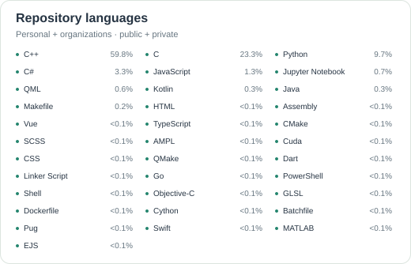

  <picture>
    <source media="(prefers-color-scheme: dark)" srcset="assets/profile-banner-dark.svg">
    
  </picture>

  
  

<!-- Portfolio 준비 후 portfolio-block.svg의 문구를 수정하고 이미지를 실제 URL의 <a>로 감싸세요. -->

 

<strong>Personal stats</strong> &nbsp; Career · Skills · Credentials

 

##### 01 · Career

- <strong>InssTek · SW 연구원</strong> 
  2022.05 – 재직중 
  로봇 제어 및 장비 SW / CAM 개발

- <strong>ETRI · 연구 인턴</strong> 
  총 4개월 
  스마트팩토리 주문 관리 시스템 유지보수

 

##### 02 · Skills

- <strong>Robotics & Control</strong> 
  ABB RAPID · RobotStudio · TwinCAT

- <strong>Software & CAM</strong> 
  C# · XAML · WPF · C++ · Qt · Rhino · ModuleWorks

- <strong>Languages</strong> 
  C# · C++ · Python · Java · TypeScript · JavaScript

- <strong>Tools</strong> 
  GitHub · VS Code · Visual Studio · Qt Creator

 

##### 03 · Credentials

- <strong>SQL 개발자 (SQLD)</strong> 
  2021 · 한국데이터산업진흥원

- <strong>영어 활용</strong> 
  해외 고객 대응 / 기술 협의

 

**Skills**

